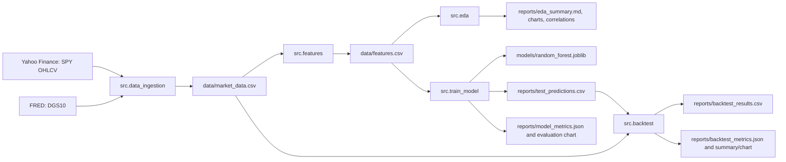

# SPY Stock Markets Analytics

Stock Markets Analytics Zoomcamp 2026 project: a reproducible pipeline that
predicts SPY's return over the next five trading days, evaluates the prediction
models chronologically, and tests a simple long-or-cash strategy against
buy-and-hold.

## Problem and objective

Can daily SPY prices, trading volume, and the US 10-year Treasury yield provide
useful information about the next five trading days' SPY return? The project
compares a training-mean baseline with a Random Forest. A separate backtest
turns only out-of-sample model predictions into positions. The results are
educational research, not evidence that the model can reliably predict markets
or earn profits.

The target is:

```text
future_5d_return(t) = SPY_adjusted_close(t + 5 trading days)
                      / SPY_adjusted_close(t) - 1
```

The final five feature rows have no observed target and are excluded from
supervised training and target analyses.

## Data and features

- **Yahoo Finance:** SPY daily OHLCV, downloaded with adjusted prices from
  2015-01-01 onward.
- **Federal Reserve Bank of St. Louis FRED:** daily `DGS10` (10-year Treasury
  constant-maturity rate), joined by date. Missing yield observations are
  forward-filled; rows still missing a yield are removed.
- **Feature engineering:** `src/features.py` sorts by date and calculates
  historical-only rolling features. It drops initial rows without enough
  history and retains the final five rows for inference.

The 14 model features are:

| Group | Features |
| --- | --- |
| Returns | `ret_1d`, `ret_5d`, `ret_20d` |
| Price versus average | `ma_5_ratio`, `ma_20_ratio` |
| Risk and activity | `volatility_20d`, `volume_ratio_20d` |
| Treasury yield | `yield_lag_1d`, `yield_change_5d` |
| Weekday indicators | `weekday_Monday`, `weekday_Tuesday`, `weekday_Wednesday`, `weekday_Thursday`, `weekday_Friday` |

Rolling windows are backward-looking. Treasury yield features are lagged to
avoid using the same-day yield as a trading signal.

## Pipeline architecture



## Repository structure

The following lists the project files tracked in Git, plus this
reproducibility guide. Market data, engineered data, and model binaries are
generated locally and ignored by Git.

```text
.
├── .github/
│   └── workflows/
│       └── market_pipeline.yml
├── docs/
│   ├── automation.md
│   └── reproducibility.md
├── reports/
│   ├── backtest_equity.png
│   ├── backtest_metrics.json
│   ├── backtest_results.csv
│   ├── backtest_summary.md
│   ├── eda.png
│   ├── eda_summary.md
│   ├── feature_correlations.csv
│   ├── feature_importance.csv
│   ├── model_evaluation.png
│   ├── model_metrics.json
│   └── test_predictions.csv
├── src/
│   ├── __init__.py
│   ├── backtest.py
│   ├── data_ingestion.py
│   ├── eda.py
│   ├── features.py
│   └── train_model.py
├── .gitignore
├── LICENSE
├── README.md
└── requirements.txt
```

## Setup and reproduce

Use Python 3.12 from the repository root. Create and activate a virtual
environment, install the pinned dependencies, and run each stage in order:

```bash
python3.12 --version
python3.12 -m venv .venv
source .venv/bin/activate
python -m pip install -r requirements.txt
python -m src.data_ingestion
python -m src.features
python -m src.eda
python -m src.train_model
python -m src.backtest
```

The first command downloads current data from Yahoo Finance and FRED, so network
access to those sources is required. The pipeline is intended to be run from
the repository root. See [docs/reproducibility.md](docs/reproducibility.md)
for expected outputs, validation steps, and troubleshooting.

### Modeling and evaluation

Rows with known targets are sorted chronologically and split 70%/15%/15% into
training, validation, and test partitions. Five rows are purged after the
training and validation partitions so their five-day target windows do not
cross into the next partition. The training-mean `DummyRegressor` and a
200-tree Random Forest (maximum depth 8, minimum leaf size 10, fixed random
seed) are fitted on training data. Validation metrics are reported separately;
the held-out test period is used for final evaluation and its predictions feed
the backtest.

Current test-period results in
[reports/model_metrics.json](reports/model_metrics.json):

| Model | MAE | RMSE | R² | Directional accuracy |
| --- | ---: | ---: | ---: | ---: |
| Training-mean baseline | 0.01569988 | 0.02169596 | -0.000024 | 57.30% |
| Random Forest | 0.01633097 | 0.02272887 | -0.097510 | 55.73% |

Returns and errors are decimal fractions (for example, 0.01 is 1%). On this
test period, the Random Forest has higher error and lower directional accuracy
than the baseline; both R² scores are negative. This is weak predictive
performance, not a basis for a profitability claim.

The current report snapshots differ slightly from earlier reference figures
(including the previously noted baseline MAE of 0.01562048 and Random Forest
MAE of 0.01625192). This README reports the values currently recorded in
`reports/model_metrics.json` and does not infer a cause for the difference.

### Trading strategy and backtest

The long-only rule holds SPY when `predicted_return > 0`, otherwise cash.
Predictions are assumed available at signal date close `t`; the position is
entered or changed at the next trading day's open (`t+1`) and applies to the
open-to-open return from `t+1` to `t+2`. Intervals without both required future
opens are skipped. The buy-and-hold benchmark uses exactly the same executable
intervals.

The backtest starts with $10,000, allows no leverage or short selling, assumes
zero interest on cash, and charges 0.1% proportional transaction costs per
unit of exposure change. Entry, position changes, and final liquidation are
included. Annualized metrics use 252 trading days and the Sharpe ratio assumes
a zero risk-free rate.

Current results from [reports/backtest_metrics.json](reports/backtest_metrics.json)
cover 445 out-of-sample intervals:

| Metric | Strategy | Buy and hold |
| --- | ---: | ---: |
| Total return | 11.04% | 24.40% |
| Annualized return | 6.11% | 13.16% |
| Annualized volatility | 16.27% | 17.38% |
| Sharpe ratio | 0.446 | 0.798 |
| Maximum drawdown | -24.29% | -19.77% |
| Position changes | 18 | 2 |
| Transaction costs | $170.85 | $22.45 |

The strategy underperformed buy-and-hold over this measured period. These
historical backtest results do not guarantee future outcomes.

## Reports and charts

- [EDA summary and target statistics](reports/eda_summary.md)
- [Feature correlations (CSV)](reports/feature_correlations.csv)
- [Target histogram and correlation chart](reports/eda.png)
- [Model metrics (JSON)](reports/model_metrics.json)
- [Test predictions (CSV)](reports/test_predictions.csv)
- [Model evaluation and feature importance chart](reports/model_evaluation.png)
- [Feature importance (CSV)](reports/feature_importance.csv)
- [Backtest summary](reports/backtest_summary.md)
- [Backtest metrics (JSON)](reports/backtest_metrics.json)
- [Backtest results and equity curves (CSV)](reports/backtest_results.csv)
- [Strategy and benchmark equity chart](reports/backtest_equity.png)
- [GitHub Actions automation guide](docs/automation.md)

## Automation

GitHub Actions runs the complete pipeline on weekdays at 23:00 UTC and
supports manual dispatch. To start it manually, open the repository's
**Actions** tab, choose **SPY Market Analytics Pipeline**, select **Run
workflow**, and confirm the branch. Run details and downloadable reports are
available from the completed workflow. See [docs/automation.md](docs/automation.md).

## Limitations and future work

- **Weak predictive performance:** the current Random Forest test MAE is worse
  than the training-mean baseline, and its test R² is negative.
- **Simplified execution:** the backtest assumes fills at recorded open prices.
  It does not model bid-ask spreads, slippage, market impact, taxes, partial
  fills, or interest earned on cash. Transaction costs are a fixed rate.
- **Data availability and revisions:** Yahoo Finance and FRED are external
  services; outages, rate limits, schema changes, and data revisions can affect
  a reproduction. Re-running ingestion can produce different snapshots and
  metrics.
- **No live trading:** this project has no brokerage integration and is not
  intended for live orders.
- **Scope:** this is a single-asset, historical experiment, not a portfolio or
  risk-management system.

Possible future work includes stronger time-series baselines, broader
walk-forward evaluation, uncertainty and regime analysis, robust transaction
cost sensitivity analysis, and tests over additional assets and periods.

> **Disclaimer:** This project is for educational research only and is not
> investment advice, a recommendation, or a promise of future performance.
